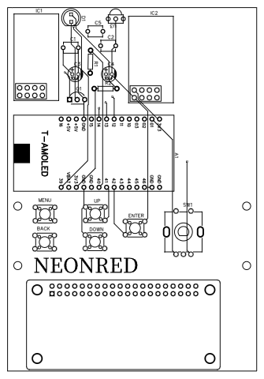
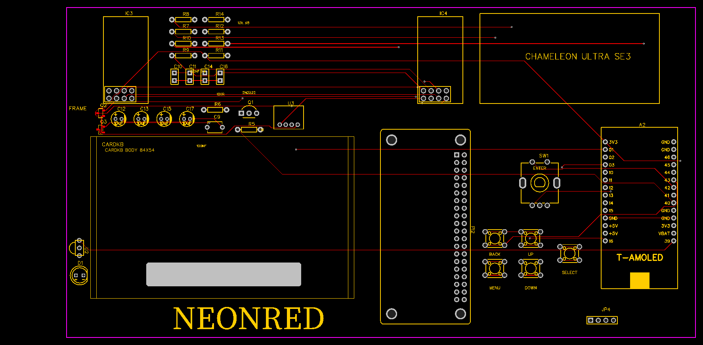
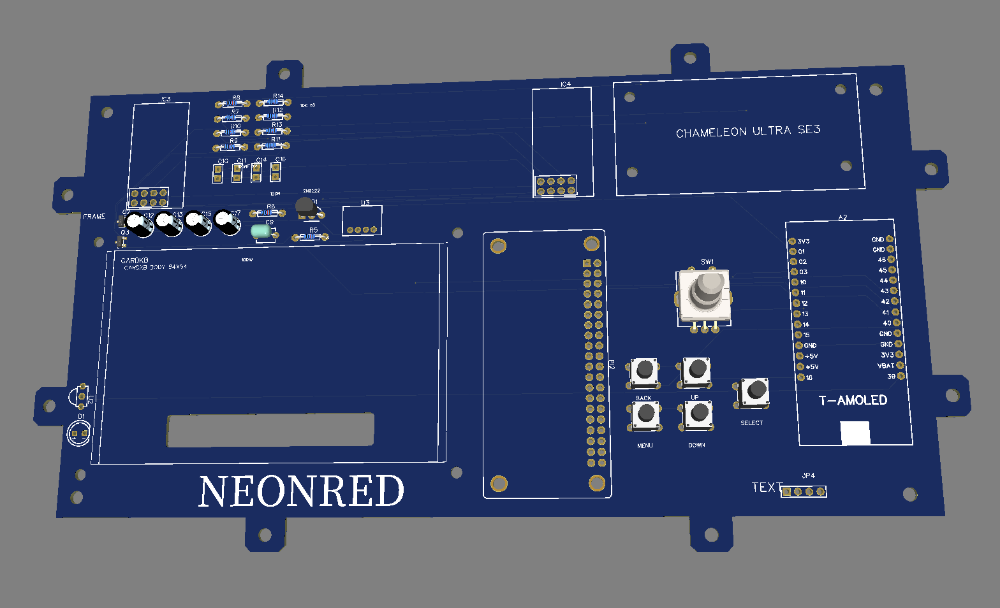

# Neonred
1. Short project description:
I am building a portable foldable-style cyberdeck. A raspberry pi 0 2 is the linux host, and I have a LILYGO T-Display-S3 AMOLED as a microcontroller. The pi will be connected to multiple parts through a USB hat including the following:
 - An ALFA dual band wifi adapter
 - A chameleon SE3 ultra
 - A 3.5" LCD HDMI screen
 - A battery
 - The esp32 which is then connected to multiple other parts including 
 - - A kardKB keyboard from M5 stack
 - - 2 NRF24L01+ modules
 - - Some buttons and a rotary encoder
 - - A ir emitter and receiver
This project will be used for a wide range of uses including wifi analysis, radio wave analysis, IR use cases, and bluetooth.
I was inspired for this project by my teacher, Mr. Lindemmann in AP Cybesecurity.

# How the design changed.
I originally started with a project of this look, and after realizing I had just connected a few parts, I decided to redesign it to be simpler, but with more parts integrated into the PCB. After trying this, I added an open source project called Proxmark 3 into the PCB, but I had many errors and it was above my level, so I decided to revert back to the original version, but integrate some parts in the PCB, which I did with the battery power supply, the IR board, rotary encoder, capacitors, and much more. Which brought me to where I am.
 # Earlier design images:
**Earlier 2026-10-09 PCB view:**

**Button-label/layout revision from 2026-10-17:**

### Current PCB 3D preview

# BOM
## Bill of materials

Prices are estimates copied from the project BOM; recheck links before ordering. Prices exclude shipping and tax. Owned parts have no purchase cost listed here.

| Part | Qty. | Status | Est. cost | Link |
| --- | ---: | --- | ---: | --- |
| Chameleon Ultra SE3 | 1 | Buy | $39.99 | [Product](https://shop.mtoolstec.com/product/chameleon-ultra-se3) |
| ATNSINC nRF24L01+ PA/LNA module kit | 1 kit | Buy | $9.99 | [Product](https://www.amazon.com/dp/B08R9F11D1) |
| ALFA AWUS036ACS dual-band Wi-Fi adapter | 1 | Buy | $26.97 | [Product](https://store.rokland.com/products/alfa-awus036acs-802-11ac-ac600-dual-band-wifi-usb-adapter-rp-sma) |
| LILYGO T-Display-S3 AMOLED | 1 | Owned | — | [Product](https://github.com/Xinyuan-LILYGO/T-Display-S3-AMOLED) |
| Raspberry Pi Zero 2 W | 1 | Owned | — | [Product](https://www.raspberrypi.com/products/raspberry-pi-zero-2-w/) |
| Waveshare USB HUB HAT SKU12694 | 1 | Owned | — | [Product](https://www.waveshare.com/usb-hub-hat.htm) |
| M5Stack CardKB v1.1 | 1 | Buy | $7.95 | [Product](https://shop.m5stack.com/products/cardkb-mini-keyboard-programmable-unit-v1-1-mega8a) |
| INIU BI-B5 20,000 mAh USB power bank | 1 | Buy | $29.99 | [Product](https://www.bestbuy.com/product/iniu-22-5w-fast-charging-20000-mah-power-bank-usb-c-in-out-portable-charger-with-led-display-for-iphone-samsung-and-more-black/JXPGH63XS6) |
| Miady 10,000 mAh USB power bank (two-pack) | 1 auxiliary bank (one unit) | Owned | — | — |
| Adafruit BSS138 I2C level shifter 757 | 1 | Buy | $3.95 | [Product](https://www.adafruit.com/product/757) |
| Bourns PEC11R-4015F-S0024 rotary encoder | 1 | Buy | $2.85 | [Product](https://www.digikey.com/en/products/detail/bourns-inc/PEC11R-4015F-S0024/4499668) |
| C&K PTS645TL50-2-LFS navigation button | 5 | Buy | $1.75 | [Product](https://www.digikey.com/en/products/detail/c-k/PTS645TL50-2-LFS/1146749) |
| FH CT4-0805B104K500PF3 100 nF radial capacitor | 3 | Buy | $0.18 | [Product](https://www.lcsc.com/product-detail/C507069.html) |
| Panasonic EEA-GA1V100 10 uF 35 V radial capacitor | 2 | Buy | $0.68 | [Product](https://www.digikey.com/en/products/detail/panasonic-industry/EEA-GA1V100/2504583) |
| Vishay TSOP38238 38 kHz IR receiver | 1 | Buy | $0.84 | [Product](https://www.digikey.com/en/products/detail/vishay-semiconductor-opto-division/TSOP38238/1681362) |
| Vishay TSAL6200 940 nm IR emitter LED | 1 | Buy | $0.50 | [Product](https://www.digikey.com/en/products/detail/vishay-semiconductor-opto-division/TSAL6200/1681339) |
| WeEn PHE13003C,412 NPN transistor, TO-92 | 1 | Buy | $1.10 (MOQ 5) | [Product](https://www.lcsc.com/product-detail/bipolar-bjt_ween-semiconductors-phe13003c-412_C256388.html) |
| Yageo CFR-25JB-52-1K axial resistor | 1 | Buy | $0.10 | [Product](https://www.digikey.com/en/products/detail/yageo/CFR-25JB-52-1K/1KQBK-ND) |
| Yageo CFR-25JB-52-100R axial resistor | 1 | Buy | $0.10 | [Product](https://www.digikey.com/en/products/detail/yageo/CFR-25JB-52-100R/100QBK-ND) |
| Pololu D24V10F3 3.3 V regulator 2830 | 1 | Buy | $12.95 | [Product](https://www.pololu.com/product/2830) |
| Adafruit USB-A plug breakout cable 4448 (power pigtail) | 1 | Buy | $1.95 | [Product](https://www.adafruit.com/product/4448) |
| M2.5 nylon standoff and screw kit | 1 kit | Buy | $9.99 | [Product](https://www.amazon.com/dp/B0FPMC9917) |
| M3 standoff and screw kit | 1 kit | Buy | $9.99 | [Product](https://www.amazon.com/dp/B0FBMFBQHQ) |
| USB-A to micro-USB data cable | 1 | Buy | $2.95 | [Product](https://www.adafruit.com/product/898) |
| USB-C data cable | 1 | Buy | $4.95 | [Product](https://www.adafruit.com/product/4474) |
| Custom carrier PCB, 2-layer, 226 × 126 mm envelope (210 × 110 mm inner area) | 1 order (5 boards) | Quote needed | TBD | [Product](https://jlcpcb.com/) |

**Estimated known-purchase subtotal: $169.72 before shipping and tax.** 

See [`BOM.csv`](BOM.csv) for more details.

## Project files

- Latest fabrication package: [`PCB/NEONRED_Gerbers_current_2026-10-19.zip`](PCB/NEONRED_Gerbers_current_2026-10-19.zip)
- Earlier Gerber packages: [`PCB/past gerbers/`](PCB/past%20gerbers/)
- Current EasyEDA source exports and audit: [`EasyEDA/`](EasyEDA/)
- Board screenshots: [`PCB/screenshots/`](PCB/screenshots/)
- Firmware: [`Firmware/`](Firmware/)
- CAD: [`cad/`](cad/)

