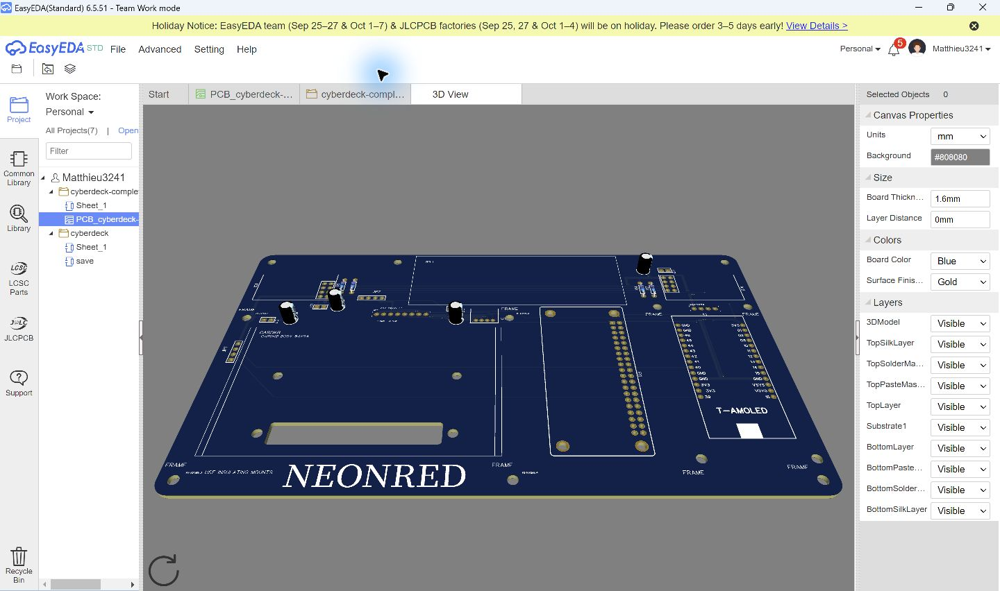
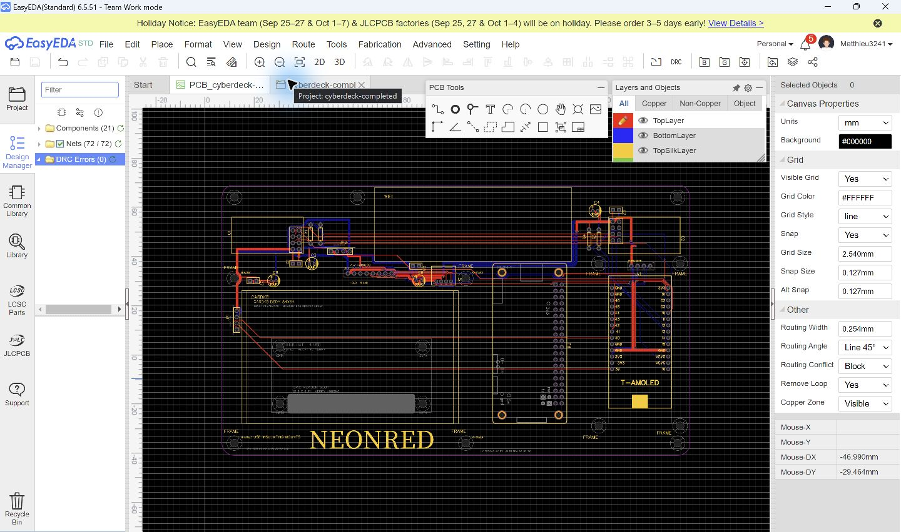
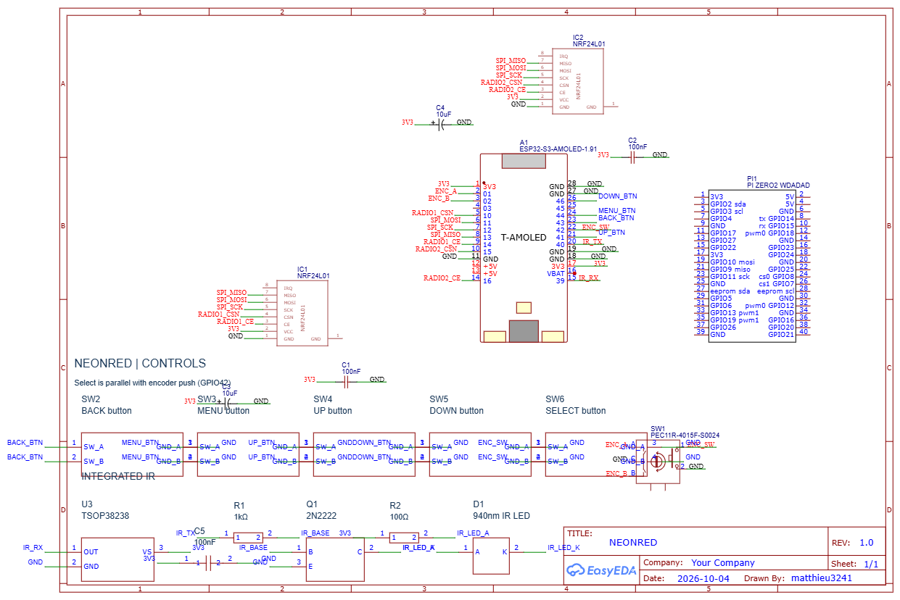
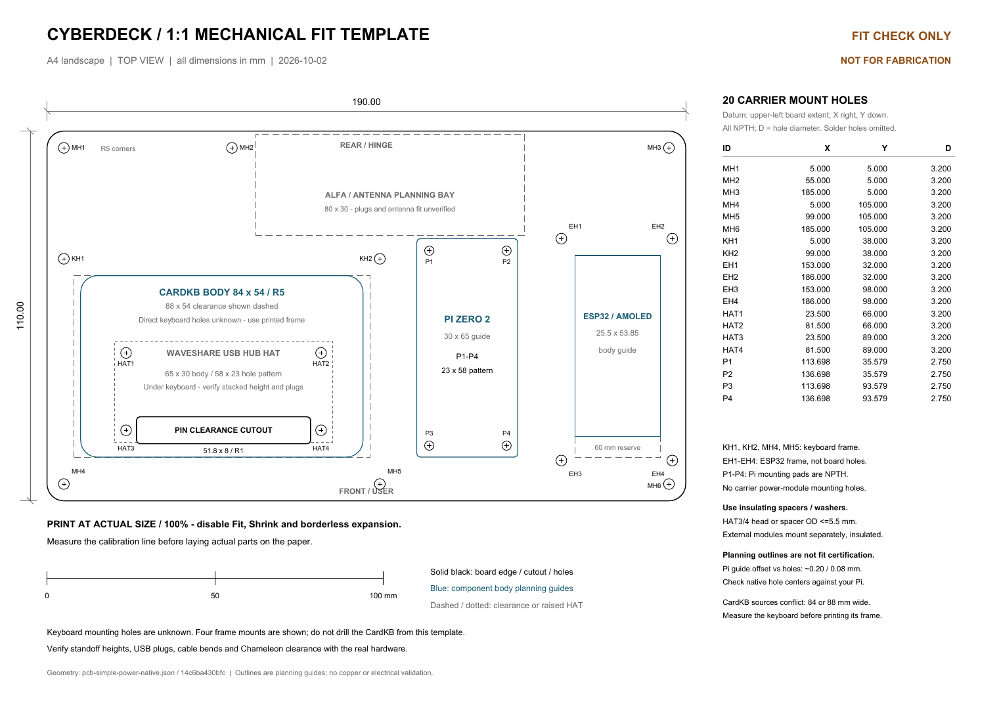

# NEONRED — Stardance README authoring worksheet

> **Working notes, not a finished README.** Stardance says project READMEs must not be AI-generated. Use these evidence-backed notes to write the final root `README.md` in your own words. Keep only claims you can personally explain and verify.

## 1. Your short project description

Write 2–4 sentences in your own voice answering:

- What are you building?
- What does it do, and how do its main parts work together?
- Why did you choose this project?

Facts you can use: NEONRED is a portable clamshell cyberdeck concept. A Raspberry Pi Zero 2 W is the Linux host; a LILYGO T-Display-S3 AMOLED is the ESP32 control/display module. The planned peripheral set includes a CardKB keyboard, rotary encoder and navigation buttons, onboard IR receive/transmit circuitry, two nRF24L01+ radio modules, a Waveshare four-port USB hub HAT beside the Pi, a 3.5-inch HDMI display, and a removable Chameleon Ultra SE3. Explain intended uses only in ways you can demonstrate or describe accurately; the assembled system has not been bench-tested.

## 2. Why you are making it

Write a personal paragraph describing what you want to learn or solve. Possible topics to address in your own words:

- fitting a Pi and ESP32 interface into a compact field terminal;
- learning PCB, enclosure, firmware, wiring, and integration workflows;
- making a serviceable design with replaceable external modules.

## 3. How the design changed

Describe these as **digital design iterations**, not physical experiments. No assembled-hardware trials or electrical load tests are recorded yet.

| Design question or problem | What changed in the digital design | Evidence / current status |
| --- | --- | --- |
| Should RFID be an integrated Proxmark circuit? | The project explored a Proxmark integration, then removed those pages/materials and returned to the external Chameleon Ultra SE3 scope to reduce circuit complexity. | Git history includes `b2ce733` (remove archived PM3 pages), `d0e312e` (remove Proxmark materials), and `47e3a10` (restore Chameleon scope). |
| Should the USB hub, USB-A ports, and microSD reader be custom-integrated? | The custom-port expansion was set aside; the current design keeps a separate Waveshare four-port USB Hub HAT. | Current scope in [`README.md`](../README.md) and [`BOM.csv`](../BOM.csv). |
| Were the controls and labels clear? | Button labels were revised after overlap and naming issues were found in the board view. | [`NEONRED-2D-button-label-fix-2026-10-17.png`](../PCB/screenshots/NEONRED-2D-button-label-fix-2026-10-17.png); commit `3e02fa4`. |
| How should the PCB attach to the enclosure and retain modules? | Case mounting lips and mechanical support holes were added while keeping the CardKB and Chameleon as separate modules. | Commits `5d00cbd`, `3b2cc06`, and `fa32c9b`; see [`mechanical validation`](../cad/MECHANICAL_VALIDATION.md). The ALFA cradle and its location remain unresolved. |
| Does a clean PCB DRC mean the deck is proven? | No. The saved PCB screenshot reports zero DRC errors, but that checks configured board rules—not device compatibility, power budget, or real operation. | [`routed PCB / DRC screenshot`](../PCB/screenshots/easyeda-current-routed-board-drc.jpg); electrical and physical validation remain open. |

Add your own dated devlog entries as you continue: what you changed, why, what did not work, what evidence you collected, and what you will try next. Ask a maker for feedback and record their actual feedback and the response; do not invent feedback or test results.

### One visual design change: board layout and controls

Use these dated screenshots to explain how the PCB layout evolved. In your own caption, say what you changed and what you still need to verify.

**Earlier 2026-10-09 PCB view:**

**Button-label/layout revision from 2026-10-17:**

## 4. Visual evidence gallery

These are **digital design screenshots**, not photographs of a built device. Add your own current screenshots when the design changes; do not imply that a rendering proves fit or function.

### Current PCB 3D preview

### Routed PCB and saved DRC view

### Earlier schematic snapshot

### 1:1 mounting and component planning template

## 5. How someone can reproduce or review the design

Fill in or verify these paths and instructions yourself before submitting:

- PCB source and schematic: [`PCB/`](../PCB/)
- Firmware sources: [`Firmware/`](../Firmware/)
- Editable enclosure/layout sources: [`cad/`](../cad/)
- Current project parts list: [`BOM.csv`](../BOM.csv)
- PCB DRC, wiring, and test status: [`docs/NEONRED_ACTIONS_AND_TEST_STATUS_2026-10-18.md`](NEONRED_ACTIONS_AND_TEST_STATUS_2026-10-18.md)
- Current Gerber archive: [`outputs/NEONRED_live_component_mounts_2026-10-19.zip`](../outputs/NEONRED_live_component_mounts_2026-10-19.zip)

Explain which software is needed to open the files, how to obtain each external module, and which wiring/power instructions must be followed. Do not tell readers to power the design until its power path has been checked and bench-tested.

## 6. Current limitations — state these plainly

- This is still a design-stage project. No complete physical prototype, operating test, runtime measurement, or power-on validation is recorded.
- The committed STEP file is the **PCB plate only**, not the full electronics-inclusive cyberdeck assembly. Stardance requires the full assembly STEP for a hardware funding request.
- The enclosure is a conceptual OpenSCAD design; clearances, cable routing, hinge motion, and real module fit are not verified. The ALFA adapter is not placed in the PCB/CAD layout and needs its real connector and cable clearances.
- The current BOM is a working list, not yet a verified final shopping list: reconcile every required part with the design, add missing items, and include current item prices and shipping in USD.
- The saved PCB DRC result is not proof of correct assembled electrical behavior or adequate power. Describe the open checks from the current status report; do not call the system “ready to use.”

## 7. Before requesting hardware funding

- [ ] Rewrite this worksheet as your own README; do not submit AI-generated wording.
- [ ] Produce a detailed electronics-inclusive CAD assembly with the case, lid, display, keyboard, Pi, hub, ESP32 board, Chameleon, PCB, cables, fasteners, and openings. Mark approximate dimensions honestly.
- [ ] Save the editable Fusion source and export the **full assembly** as STEP. The existing STEP is only the PCB plate.
- [ ] Add a current full-device CAD render, current PCB screenshot, and current wiring/schematic screenshot. The gallery above contains PCB evidence, but the schematic image is dated and should be refreshed.
- [ ] Complete the BOM with quantities, purchase links, current item prices, and shipping costs in USD; confirm that the HDMI display and every other required item are included.
- [ ] Add a real design journal/devlog and actual outside feedback as you receive it.
- [ ] Review Stardance's current funding instructions and submit the public repository from your Stardance project page.

Check the [Stardance hardware shipping guide](https://stardance.hackclub.com/resources/shipping-hardware) again before submission; its instructions can change.
